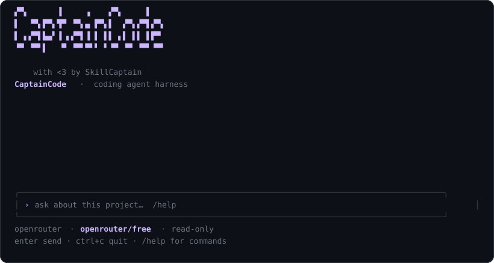

# CaptainCode

**A coding agent you can audit, because a model's output is a request, not an action.**

[](https://github.com/john-nash-rs/captaincode/actions/workflows/verify.yml)
[](https://github.com/john-nash-rs/captaincode/releases/latest)
[](LICENSE)
[](go.mod)
[](https://github.com/john-nash-rs/captaincode#supported-platforms)

An agent harness in Go, for one person on one machine. It wraps a model in an
explicit tool contract, a bounded agent loop, OS-enforced sandboxing, and durable
run state — so that what the system did is a matter of record rather than of
trust.

> **Status: 0.3.3.** A single-operator tool, not a hosted service. It is designed
> to be read, run, and audited. It is not hardened for multi-tenancy or
> adversarial use. See [Limitations](#limitations).



```sh
brew install john-nash-rs/tap/captaincode      # or the one-line installer below
captaincode                                   # then type /connect
```

[Installation](#installation) · [Commands](#commands) · [Design](#design) ·
[Limitations](#limitations) · [Contributing](#contributing)

## Should you use this?

Probably not, unless some of these are true of you:

- **You need to know what your agent actually did.** Every tool call is recorded
  with its real output. Nothing is inferred from what the model says it did.
- **You want to read the harness, not just run it.** Eight packages, about 12k
  lines of Go including tests, no framework, no runtime dependency.
- **You are running one model against one project** and want that to be auditable
  end to end.

**And explicitly not, if any of these are true:**

- **You need Windows.** There is no Windows build. The source compiles, but
  there is no isolation backend, and CaptainCode refuses to run tools unsandboxed
  rather than run them unsandboxed and call it a feature.
- **You want per-command approval prompts.** Permissions are coarse
  project-wide grants. There is no "allow this one call?" dialog.
- **You want the smallest thing that works.** This is more machinery than a
  script that shells out to `claude -p`.
- **You need it to be fast at scale.** The core loop is serial and has no
  concurrent scheduler outside the labs.

If none of that sounds like your problem, [Aider](https://github.com/Aider-AI/aider),
[opencode](https://github.com/sst/opencode), or
[Claude Code](https://github.com/anthropics/claude-code) will serve you better.

## Why it exists

Most agent failures are not model failures. A model that writes a perfectly good
patch still causes damage when the harness cannot answer four questions:

| Question | CaptainCode's answer |
|---|---|
| What was actually executed? | Nothing happens until intent is committed to durable state |
| What did the tool actually observe? | Every tool result is recorded; claims are never inferred |
| What if the process died mid-write? | The run is **blocked** for reconciliation, never reported as successful |
| What is this tool allowed to touch? | The sandbox decides, and there is no unsandboxed fallback |

## Design

Eight packages, each owning one responsibility:

| Package | Responsibility |
|---|---|
| `core` | The agent loop, budgets, context selection, run phases |
| `toolbox` | Tool contracts: validation, path containment, stale-edit detection |
| `sandbox` | OS-enforced isolation via `sandbox-exec` (macOS) or `bubblewrap` (Linux) |
| `storage` | SQLite snapshots and an event index with atomic commit |
| `provider` | OpenRouter adapter with an offline deterministic fixture |
| `keyring` | Credential resolution and private storage |
| `config` | Settings resolution and validation |
| `ui` | Bubble Tea terminal interface |

Two principles run through all of them:

**Deny by default.** Writes and shell commands are disabled. The sandbox refuses
to start rather than silently running tools without isolation. A failed setup is
an error, never a quiet downgrade to something less safe.

**Preserve uncertainty.** When an operation's outcome is unknown, CaptainCode
records it as unknown. A lost HTTP reply after a commit does not become a retry;
it becomes a blocked run that requires a human.

## Installation

### Homebrew

```sh
brew install john-nash-rs/tap/captaincode
```

No tap step needed. To tap first and install unpinned by formula name:

```sh
brew tap john-nash-rs/tap && brew install captaincode
```

### Shell installer

```sh
curl -fsSL https://raw.githubusercontent.com/john-nash-rs/captaincode/main/install.sh | sh
```

> **This is the current, working URL.** No custom domain has been configured,
> so the installer is served from the repository. If one is published later,
> `install.sh` and this section are updated together.

The installer resolves the latest release through the GitHub API, downloads
the archive for your platform, verifies its SHA-256 against the release's
`checksums.txt`, and only then installs it into `~/.local/bin`. No privileges
are required.

```sh
sh install.sh --version v0.3.3        # pin a specific version
sh install.sh --dir ~/bin            # choose the install directory
sh install.sh --help
```

> **Risk of piping a remote script into a shell.** This executes whatever the
> remote host serves, with your privileges, before you read any of it. Prefer
> downloading and reading it first:
>
> ```sh
> curl -fsSLO https://raw.githubusercontent.com/john-nash-rs/captaincode/main/install.sh
> less install.sh
> sh install.sh
> ```
>
> It is 326 lines and its only network fetches are the release metadata, your
> platform's archive, and `checksums.txt`.

### Manual download

Grab the archive and `checksums.txt` from
[GitHub Releases](https://github.com/john-nash-rs/captaincode/releases):

```sh
VERSION=v0.3.3
OS=$(uname -s | tr '[:upper:]' '[:lower:]')
ARCH=$(uname -m | sed 's/x86_64/amd64/;s/aarch64/arm64/')
ARCHIVE="captaincode_${VERSION#v}_${OS}_${ARCH}.tar.gz"

curl -fsSLO "https://github.com/john-nash-rs/captaincode/releases/download/$VERSION/$ARCHIVE"
curl -fsSLO "https://github.com/john-nash-rs/captaincode/releases/download/$VERSION/checksums.txt"

# checksums.txt lists all four platforms, so verify only the line for the
# archive you downloaded. `shasum -c checksums.txt` on its own reports the
# other three as missing and warns, even when your download is correct.
grep " $ARCHIVE\$" checksums.txt | shasum -a 256 -c

tar -xzf "$ARCHIVE"
install -m 0755 captaincode ~/.local/bin/captaincode
```

**Verify the checksum before running anything.** A mismatch means the download
is corrupt or was tampered with. The verification above prints
`captaincode_….tar.gz: OK` and exits `0`; a mismatch prints `FAILED` and exits
non-zero.

Note there is no `sudo` above. `install` writes to `~/.local/bin`, which is yours
already. If that directory is not on your `PATH`, see
[PATH troubleshooting](#path-troubleshooting).

### Supported platforms

| OS | Architectures |
|---|---|
| macOS | `arm64` (Apple Silicon), `amd64` (Intel) |
| Linux | `amd64` (x86-64), `arm64` (aarch64) |

Linux requires kernel **3.10+**. Windows is not supported.

### Verify the installation

```sh
captaincode version
captaincode --version
captaincode doctor
captaincode --help
```

`doctor` checks that the sandbox backend this platform needs is present. It
reports and never repairs: CaptainCode refuses to run tools without isolation
rather than falling back to running them unsandboxed.

### Sandbox prerequisites

Installing the binary does **not** install its sandbox dependency.

| Platform | Backend | Action |
|---|---|---|
| macOS | `/usr/bin/sandbox-exec` | Ships with the OS. Deprecated by Apple; host or MDM policy may remove it. |
| Linux | `bubblewrap` (`bwrap`) | `sudo apt-get install bubblewrap`, plus unprivileged user namespaces |

If `doctor` reports a missing sandbox, tools will not run. That is the
intended behaviour, not a bug.

### Upgrade

```sh
brew upgrade captaincode                          # Homebrew
curl -fsSL https://raw.githubusercontent.com/john-nash-rs/captaincode/main/install.sh | sh    # shell installer
```

Or download the new release manually. Check [releases](https://github.com/john-nash-rs/captaincode/releases)
for what changed.

### Uninstall

```sh
brew uninstall captaincode                        # Homebrew
rm ~/.local/bin/captaincode                       # shell installer
```

Your settings and your stored credential live outside the binary and are **not**
removed by uninstalling. To find where they actually are on your machine:

```sh
captaincode doctor
```

It prints the paths in force. To remove them by hand:

| What | Where |
|---|---|
| Settings | `~/.captaincode.json` |
| Credential | `<user-config-dir>/captaincode/openrouter.key` |
| Run databases | `<user-config-dir>/captaincode/*.db` |

`<user-config-dir>` is `~/.config` on Linux and
`~/Library/Application Support` on macOS. `captaincode doctor` prints the
resolved path rather than making you work out which one applies.

Remove the credential file if you are uninstalling for security reasons.

### PATH troubleshooting

`command not found: captaincode` after installing means the install directory
is not on `PATH`. The installer prints the exact line to add. For `~/.local/bin`:

```sh
# pick the one matching your shell
echo 'export PATH="$HOME/.local/bin:$PATH"' >> ~/.zshrc    # zsh
echo 'export PATH="$HOME/.local/bin:$PATH"' >> ~/.bashrc   # bash
echo 'export PATH="$HOME/.local/bin:$PATH"' >> ~/.profile  # sh
```

The single quotes matter. With double quotes, `$HOME` and `$PATH` expand when
the line is written, baking the current shell's values into the file; single
quotes leave them to expand when each new shell starts.

Then open a new shell. Confirm with `captaincode version`.

### Build from source

```sh
git clone https://github.com/john-nash-rs/captaincode.git
cd captaincode
go mod download
go test ./...
go build -o bin/captaincode ./cmd/captaincode
```

A binary built this way reports `captaincode dev` and says it is an unreleased
build. Release builds embed their version via the linker.

## Troubleshooting

**`command not found: captaincode`.** The install directory is not on `PATH`.
See [PATH troubleshooting](#path-troubleshooting).

**`brew install captaincode` cannot find the formula.** Confirm the tap has a
cask for your version:

```sh
brew tap john-nash-rs/tap
brew info captaincode
```

If the tap lists no formula, the cask has not been published for that release.

**`captaincode doctor` reports the sandbox missing.** This is the expected
result when the platform dependency is absent, not a broken install. See
[Sandbox prerequisites](#sandbox-prerequisites). CaptainCode will not run tools
without isolation.

**Installer: `CHECKSUM MISMATCH`.** The download is corrupt or was tampered
with. Nothing was installed. Retry, and if it persists, download manually and
compare against the release's `checksums.txt`.

**Installer: `unsupported architecture`.** There is no prebuilt binary for your
platform. Build from source instead.

**Installer: `cannot create ~/.local/bin`.** Choose a writable location:

```sh
sh install.sh --dir ~/bin
```

**Tools do not run, but `captaincode version` works.** Installing the binary
does not install the sandbox. Run `captaincode doctor`. On Linux, install
bubblewrap. On macOS, check that `/usr/bin/sandbox-exec` still exists — it is
deprecated and host or MDM policy may remove it.

**`database must be outside the tool workspace`.** The `--db` path resolved
inside the directory being exposed to tools. Pick another location.

**`--tui was removed`.** The interface is the default. Use `captaincode .`, or
add `--ide=false` for one-shot output.

**`the interface needs a terminal on stdin and stdout`.** You are running
without an interactive terminal — a pipe, a script, or CI. Add `--ide=false`.

## Quick start

Run in the current project:

```sh
captaincode --ide=false
```

```
The project version is 2.5.0 (package.json).
Run: 526e845c47c9161ecafe395fe6776714
```

That output is the **offline fixture**, shown because a machine with no
credential and no model set up gets one. Once you have run `/connect`, the same
command answers from your model instead. See [Which provider
runs](#which-provider-runs).

Run in another project:

```sh
captaincode ./myproject --ide=false
```

Omit `--ide=false` to get the interactive interface instead:

```sh
captaincode ./myproject
captaincode
```

Flags may appear before or after the directory. `--tui` was removed in 0.2.0;
the interface is the default and `--ide=false` selects the previous one-shot
behaviour.

### Which provider runs

You do not need `--provider`. It is resolved from your configuration:

| You have | Runs |
|---|---|
| A model **and** a credential | OpenRouter — your configured model |
| Neither | An offline fixture that needs no key or network |

Either one alone counts as unconfigured, because a half setup cannot work.

This matters because the failure is silent. The offline provider starts
normally, accepts a prompt and answers — from a fixed script. Nothing errors, so
nothing tells you the provider you configured was not in force. The footer names
whichever provider is actually running, so if it says `fixture`, you are on the
offline one.

Force one either way with `--provider`:

```sh
captaincode ./myproject --provider fixture     # offline, ignores your key
captaincode ./myproject --provider openrouter  # hosted, even if half configured
```

### Database location

Each workspace gets its own database under the user config directory, named
`<directory>-<hash>.db`. Two projects therefore never collide, and the same
project always maps to the same file so `--resume` works without repeating
`--db`.

`captaincode doctor` prints the path in force.

Override it when you want the database somewhere specific:

```sh
captaincode ./myproject --db ~/.local/share/captaincode/myproject.db
```

The database must stay **outside** the workspace, since the workspace is what
tools are allowed to see.

### The terminal interface

```sh
./bin/captaincode ./testdata/project
```

Type a question and press Enter. Type while a run is active and it queues.
**Escape** cancels the underlying request, not just the display. `Ctrl+C`
exits once the current run has recorded its outcome.

The footer always reports the connected provider, model, and permission grants
in force. It states what is connected — it never infers it.

### Commands

Prefix a line with `/` to run an interface command. These are handled inside the
interface and are never sent to a model. **Tab** completes to the highlighted
suggestion.

| Command | Effect |
|---|---|
| `/connect` | Set up a key and a model, then verify the connection |
| `/status` | Show what is configured and check that it works |
| `/models` | Pick a model from a list of the ones your account can use |
| `/permissions` | Show or change what may be edited or run |
| `/tools` | List the tools available and whether each is granted |
| `/help` | List every command |
| `/openrouter` | Report provider, model, credential, and keyfile path |
| `/openrouter api-key` | Store a credential — paste or type; nothing is echoed |
| `/openrouter model` | Open the model picker |
| `/openrouter model <id>` | Set a model by identifier |
| `/openrouter clear-key` | Remove the stored credential |
| `/openrouter path` | Print the keyfile path |

`/perm` and `/config` are accepted as aliases of `/permissions` and `/openrouter`.

Type `/` and the list appears. **↑** and **↓** — or a click — move the highlight,
**enter** runs it, **tab** completes. Copy and paste work throughout.

### Talking to it

Prompts continue a conversation. Asking for a Flask app and then saying "save
it in a file" works, because the second prompt carries the first exchange with
it.

```
› give me hello world api in flask
  ```python
  from flask import Flask …
  ```

› save it in a file
  Written to app.py, 12 lines.
```

Each prompt is still its own **run** with its own turn and tool-call budget,
which is what `--resume` refers to. A run that failed or ran out of budget is
not continued, because it may have applied some of its tool calls; the
conversation restarts and says so.

### Giving it permission to edit your project

Read-only is the default. The model will tell you it cannot save a file, and
you can grant that from inside the interface:

```text
/permissions               show what is allowed
/permissions writes on     allow editing files here
/permissions commands on   allow running programs here
/permissions all off       back to read-only
```

Grants apply immediately, with no restart. They are project-wide and coarse:
there is no per-call approval prompt, so use a disposable copy when
experimenting. Tools stay inside the OS sandbox and inside the project
directory regardless.

Run `/connect`. It asks for whatever is missing and finishes by checking that the
model actually answers:

1. **API key.** Paste it or type it. The field shows `paste your API key` when
   empty and a growing mask once there is something there, so an empty field
   never looks filled. Saving prints a confirmation and the file it went to.
2. **Model.** A list of the models your account can use, free ones first, each
   with its price. Type to filter, **↑**/**↓** or a click to choose, **enter** to
   use it. There is nothing to memorise or copy off a web page.
3. **Check.** One request that verifies the key is accepted and the model
   exists. It costs nothing and says which of the two failed if either did.

Both settings are written to `~/.captaincode.json`, so the next run is already
connected. A missing credential is **not** a startup error, so you can always get
into the interface to run this.

`/status` re-checks later without changing anything. The footer shows
`connected`, `unverified`, or `not connected` — a model named in your settings
is not the same thing as one that answers.

**When a request fails**, the cause is named and the remedy printed underneath:

```
Error: thinkingmachines/inkling:free is only available on agentic harnesses.
  This free model is restricted to approved coding apps. Pick a paid one with /models.
  run /models to pick a different model
```

**On the free tier.** OpenRouter gates `:free` models to registered agentic
harnesses, and CaptainCode is not on that list. Roughly half the free models
answer `403`; the rest are rate limited per account per day. The picker shows
each model's price and keeps the provider's coding ranking, so nothing is
promoted ahead of what actually works.

### Reading back

The conversation is written to the terminal as it happens, so the terminal's own
scrollback holds all of it. The wheel, the scrollbar, the mouse drag, and the
terminal's search all work over the whole session, exactly as they do for
`git log` or a compiler. Output fills the screen from the top and older answers
scroll away above the prompt as new ones arrive.

Nothing is captured while you are reading: the interface asks for mouse reporting
only while the command menu or the model picker is on screen, and releases it the
moment that closes. The arrows belong to whichever list is open, so a model can
still be chosen; there is no in-frame scrolling to compete with the terminal's.

Credentials resolve per request, so rotating a key or changing a model takes
effect immediately.

```sh
captaincode ./testdata/project --provider openrouter --model openrouter/free
```

`--model` applies to that one run. To make it stick, either run `/connect` or
`/openrouter model <id>` in the interface, which writes it to the settings file
described under [Configuration](#configuration).

`OPENROUTER_API_KEY` overrides the stored file for a single shell session.

**Where the credential lives.** `OPENROUTER_API_KEY` first, then
`<user-config-dir>/captaincode/openrouter.key` — a `0600` file inside a `0700`
directory. It is written through a temporary name so a crash cannot leave a
partial credential. It is never written into the configuration file, never
placed in the conversation transcript, and displayed as at most its final four
characters. `/openrouter path` prints the location so you can delete it.

This is a bearer secret protected by filesystem permissions alone. There is no
OS keychain integration, no encryption at rest, and no rotation policy.

Requests are sent to OpenRouter and its routed provider. **This can incur
charges**, and selected project content leaves your machine.

## Configuration

There is one settings file: `~/.captaincode.json`.

`/connect` writes it for you — run `captaincode` to get the interface, then type
`/connect`. Most people never need to open it. Use `--config <path>` to read a
different file for one run — that is how you keep per-project settings:

```sh
captaincode --config ./deploy.json .
```

Not having the file is not an error. A `--config` path that does not exist *is*
an error, because asking for one specific file and silently getting defaults
would hide a typo. A file that exists but does not parse is always an error.

`doctor` prints which file is in force, and whether it names a model:

```sh
captaincode doctor --provider openrouter
```

```text
  ✓  config   /Users/you/.captaincode.json  model openrouter/free
```

A `--model` on the command line overrides the file for one run and is not
written back to it.

| Field | Default | Meaning |
|---|---|---|
| `max_turns` | `12` | Ceiling on model round-trips per run |
| `max_tool_calls` | `24` | Ceiling on tool invocations per run |
| `context_bytes` | `65536` | Serialized conversation bound |
| `output_bytes` | `8192` | Per-tool output cap |
| `tool_timeout_seconds` | `15` | Per-tool deadline |
| `run_timeout_seconds` | `180` | Whole-run deadline |
| `model` | — | Provider model identifier |
| `allow_writes` | `false` | Coarse grant for the exposed project |
| `allow_commands` | `false` | Coarse grant for the exposed project |

Unknown fields, out-of-range values, and trailing JSON are rejected rather than
ignored. Fields you leave out keep their defaults.

### Tools

Everything is implemented in Go against `os.Root` and `path/filepath`, so
behaviour follows the target filesystem rather than one platform's
conventions. No interpreter is required at runtime.

| Tool | Needs | Effect |
|---|---|---|
| `read_file` | — | Read a bounded text file |
| `list_files` | — | List one directory |
| `search_files` | — | Find a literal string |
| `stat_file` | — | Report existence and kind |
| `create_file` | writes | Create an empty file; refuses to overwrite |
| `write_file` | writes | Create or replace, with a hash check |
| `append_file` | writes | Append, creating if absent |
| `make_directory` | writes | Create a directory and parents |
| `move_path` | writes | Rename or move |
| `delete_path` | writes | Delete a file or an *empty* directory |
| `run_command` | commands | Run a program, bounded by a timeout |

A non-empty directory is refused rather than emptied. Removing the workspace
root is refused outright. Every path is checked against the workspace before
any syscall, so `..` and absolute paths cannot escape. `/tools` lists these with
the grant each one currently needs.

Enabling writes or commands is a **coarse project-wide grant, not a per-call
approval.** There is no interactive approval prompt. Use a disposable copy of
your project when experimenting.

### Platform support

| | Released | Talks to a model | Runs tools |
|---|---|---|---|
| macOS | yes | yes | yes, via `sandbox-exec` |
| Linux | yes | yes | yes, via `bubblewrap` |
| Windows | **no** | — | — |

**No Windows build is published.** The source compiles for Windows and the
conversation, provider and database layers all work there, but there is no
isolation backend, and CaptainCode refuses to run tools unsandboxed rather than
running them unsandboxed and calling it a feature. Publishing a binary where
the central capability is missing would be worse than publishing none.

What is already done for Windows, so that adding a backend is not a port from
scratch: the database lock uses `LockFileEx` rather than `flock`, process
setup is split from the POSIX-only `Setpgid` path, and `doctor` reports the
missing backend as a failure rather than a warning.

Two gaps are documented in the source rather than left to be discovered:
process cancellation on Windows kills the immediate child rather than the whole
tree, because Windows has no equivalent of `kill(-pgid)` and job objects are
not yet wired up.

The context bound is measured in serialized bytes, not provider tokens. Old
assistant and tool groups may be dropped, which loses evidence; there is no
summarization or retrieval layer.

## Recovery semantics

```sh
./bin/captaincode ./testdata/project --ide=false --resume RUN_ID
```

| Phase on restart | Behavior |
|---|---|
| `completed` | Returns the saved answer; no new model or tool events |
| `cancelled`, `failed`, `blocked` | Terminal; refuses to resume |
| interrupted **read** | Safe to repeat; re-executes |
| interrupted **mutation**, outcome known | Recorded |
| interrupted **mutation**, outcome unknown | **Blocked** for operator reconciliation |

There is no automatic reconciliation service. **A checkpoint cannot provide
exactly-once external effects.**

## Learning checkpoints

The repository contains runnable chapter entry points:

```sh
./checkpoint 02      # standalone minimal agent loop
./checkpoint 10      # idempotency and lost replies
./checkpoint 18      # the assembled harness
```

See [the checkpoint map](checkpoints/README.md). Retry and concurrent scheduling
are separate labs under `labs/`; the core loop is serial and does not
automatically retry provider requests.

## Verification

```sh
go mod verify
go vet ./...
gofmt -l .
go test -race -count=1 ./...
CAPTAINCODE_SANDBOX_TEST=1 go test -count=1 ./sandbox
go run golang.org/x/vuln/cmd/govulncheck@v1.9.0 ./...
```

The sandbox probes are opt-in because they launch real processes and require
loopback listeners. They assert both permitted and forbidden operations. If
isolation cannot be established, tool execution fails — there is no fallback.

`govulncheck` queries public vulnerability data at run time. It is dated
evidence, not a security proof.

### Continuous integration

`verify.yml` runs the suite on every push across `ubuntu-22.04` and `macos-14`.
`release.yml` gates releases: it runs the same checks, validates the GoReleaser
configuration, and then publishes.

GitHub-hosted runners cannot run every check. The sandbox probes need to build a
network namespace and add a loopback address inside it, which the `ubuntu-24.04`
image forbids, so the release gate uses `ubuntu-22.04`. See
[Maintaining a release](#maintaining-a-release).

Action versions are pinned to commit SHAs, not tags, so a moved tag cannot
change what runs in CI.

## Limitations

Read [LIMITATIONS.md](LIMITATIONS.md) before exposing a sensitive workspace. The
material ones:

- Core execution is **serial**; bounded retries and a concurrent scheduler exist
  only as labs.
- Permissions are **coarse grants**, not per-call approvals.
- macOS isolation uses a **deprecated** Apple interface.
- No resource quotas for CPU, memory, or disk; no seccomp policy.
- Configuration is not fully snapshotted; a database is bound to one workspace
  **path**, not an immutable image.
- Unknown mutations **block** for reconciliation.
- The terminal interface has no live-token rendering, no approval dialog, and no
  conversation steering.

## Contributing

Issues and pull requests are both welcome. The most useful contributions are a
Windows sandbox backend, a benchmark with its method stated, and a concurrency
scheduler for the serial core loop.

See [CONTRIBUTING.md](CONTRIBUTING.md) for what is welcome, what will be
declined, and why. For a security problem, please do not open a public issue —
see [SECURITY.md](SECURITY.md).

## License

MIT — see [LICENSE](LICENSE). Dependency licenses are inventoried in
[THIRD_PARTY_NOTICES.md](THIRD_PARTY_NOTICES.md).

CaptainCode is not affiliated with or endorsed by OpenRouter, Anthropic, or any
model provider.

## Maintaining a release

Releases are driven entirely by GitHub Actions. Nothing is published by hand.

**1. Configure the token** (once). The cask is pushed to the separate
`john-nash-rs/homebrew-tap` repository, so it needs a token the workflow's own
`GITHUB_TOKEN` cannot provide. The tap already exists and is initialised — see
[homebrew-tap/README.md](homebrew-tap/README.md).

```sh
gh secret set HOMEBREW_TAP_TOKEN --repo john-nash-rs/captaincode
```

Use a fine-grained token with contents read-write on `homebrew-tap` only. It
cannot be named `GITHUB_PERSONAL_AUTH_TOKEN` as some GoReleaser guides
suggest — GitHub reserves the `GITHUB_` prefix and rejects the name.

Verify the token without pasting it into a chat or a file:

```sh
read -s TOKEN && echo
curl -s -o /dev/null -w "%{http_code}\n" -H "Authorization: Bearer $TOKEN" \
  https://api.github.com/repos/john-nash-rs/homebrew-tap
```

`200` works. `401` means GitHub does not recognise the value at all — wrong,
revoked, or expired. `403` means it is valid but lacks write access.

**2. Tag and push.**

```sh
git tag -a v0.4.0 -m "CaptainCode 0.4.0"
git push origin v0.4.0
```

The workflow runs tests, validates the GoReleaser config, builds all four
targets, publishes the archives with `checksums.txt`, and updates the cask.

**Verifying without publishing.** Build the exact artifacts locally:

```sh
goreleaser check
goreleaser release --snapshot --clean --skip=publish
ls dist/
sh -cd dist && shasum -a 256 -c checksums.txt
```

### Things that will bite you

Every item here was hit while publishing 0.1.0. They are properties of the
environment, not of this code.

**Releases cannot be re-run.** GitHub rejects a second upload of an asset that
already exists, and the failure happens before the cask is pushed:

```
422 Validation Failed [{Resource:ReleaseAsset Field:name Code:already_exists}]
```

So re-running the workflow is not a way to repair a broken cask. To re-release
the same version, delete the assets or the release first:

```sh
gh release delete v0.4.0 --repo john-nash-rs/captaincode --yes
git push origin :refs/tags/v0.4.0
```

That leaves a window with no binaries, so prefer a new version number.

**A failed cask push does not roll back the release.** On 0.1.0 the archives
published successfully and only the tap push failed; the release stayed live
while the workflow reported failure. Publish the cask by hand from `dist/` and
nothing is lost.

**The verify gate cannot run on `ubuntu-24.04`.** The sandbox probes build a
network namespace and add a loopback address inside it, and that runner image
runs jobs in a container which forbids `RTM_NEWADDR`, so bubblewrap fails with
`Failed RTM_NEWADDR: Operation not permitted`. The gate runs on `ubuntu-22.04`
for that reason. Do not bump it without moving to a runner that permits these
namespaces.

**Do not validate the config with `go run`.** GoReleaser 2.18.3 requires Go
1.27.1 or newer, and the project pins Go 1.26.9 with `GOTOOLCHAIN=local`. The
workflow installs GoReleaser as a binary in `install-only` mode instead, so one
version both validates the configuration and performs the release.
